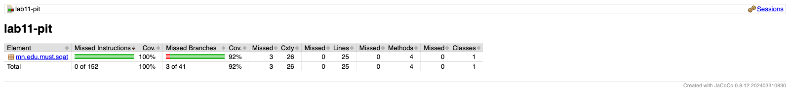
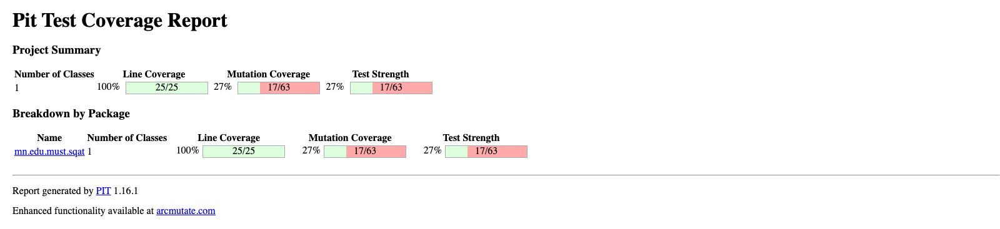
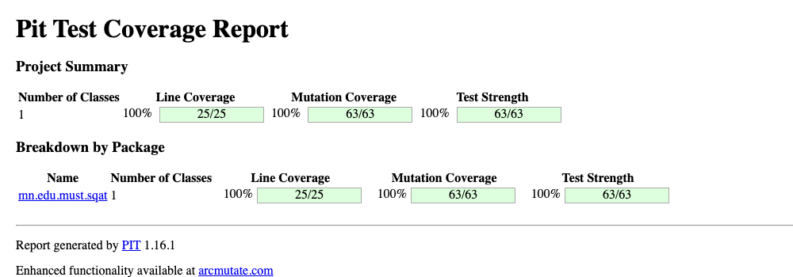

# Лаб 11 — Mutation testing: PIT-ээр тестийн чанараа хэмжих

- **Нэр:** Н.Ням-Од
- **Оюутны код:** B222270805
- **Хичээл:** F.CSA313 — Программ хангамжийн чанарын баталгаа ба туршилт
- **Төсөл:** `ScholarshipCalculator` — `letterGrade`, `gpa`, `scholarship`

## Орчин

`java -version`:

```text
java version "23.0.2" 2025-01-21
Java(TM) SE Runtime Environment (build 23.0.2+7-58)
Java HotSpot(TM) 64-Bit Server VM (build 23.0.2+7-58, mixed mode, sharing)
```

`mvn -version`:

```text
Apache Maven 3.9.12 (848fbb4bf2d427b72bdb2471c22fced7ebd9a7a1)
Maven home: /opt/homebrew/Cellar/maven/3.9.12/libexec
Java version: 25.0.2, vendor: Homebrew, runtime: /opt/homebrew/Cellar/openjdk/25.0.2/libexec/openjdk.jdk/Contents/Home
Default locale: en_MN, platform encoding: UTF-8
OS name: "mac os x", version: "26.5", arch: "aarch64", family: "Mac OS X"
```

Төсөл `maven.compiler.release=17`-оор компилддаг; Maven өөрөө JDK 25.0.2 дээр ажилладаг.

## Ажиллуулах команд

```bash
mvn clean verify
mvn test-compile org.pitest:pitest-maven:mutationCoverage
```

- JaCoCo HTML тайлан: `target/site/jacoco/index.html`
- PIT HTML тайлан: `target/pit-reports/index.html`

## Эхлэлийн хэмжилт

Starter кодыг өөрчлөхгүйгээр `mvn clean verify` болон PIT-ийн `STRONGER` мутаторуудыг ажиллуулсан үр дүн:

| Хэмжүүр | Хамрагдсан / нийт | Хувь |
|---|---:|---:|
| JaCoCo Instruction | 152 / 152 | 100% |
| JaCoCo Branch | 38 / 41 | 92% |
| JaCoCo Line | 25 / 25 | 100% |
| PIT Mutation Coverage | 17 / 63 | 27% |
| PIT-д амьд үлдсэн мутант | 46 / 63 | 73% |





Бодит гаралтууд: `results/mvn-verify-start.txt`, `results/jacoco-start.csv`, `results/pit-start.txt`.

**Ажиглалт.** JaCoCo бүх 25 мөрийг хамрагч тул Line Coverage 100% байхад PIT 63 мутантын зөвхөн 17-ыг агнаж 46 нь амьд үлдсэн нь тестүүд кодыг ажиллуулсан ч буцаасан үр дүн, зааг утг, нөхцөлийн нарийн ялгааг шалгаагүйг харуулж байна. Хамралт бол кодын хэд хэдэн мөрийг ажиллуулсан эсэхийг хэмжих хэмжүүр юм бол mutation score тестийн баталгааны чанарыг илүү шууд илрүүлдэг. Тиймээс өндөр line coverage-ийг зөвхөн өөрөө онооны шалгалт гэж үзэх боломжгүй.

## Хэсэг A — Амьд мутантуудын ангилал

Starter PIT тайлангийн `SURVIVED` мутант бүрийг эхний `ScholarshipCalculator.java` мөрөнд нь ангилсан. Ижил мөр дээрх ижил шалтгаантай мутацийг нэг мөрөнд нэгтсэн бөгөөд тоо нь зөвхөн тайлбарын тоо биш, PIT-ийн бодит мутацийн тоо. Доорх 15 мөрийн нийлбэр **46**; B1-ийн дараа PIT-ийн `switch` мутатор яг GPA тестээр агналгааж байгаа тул Starter үеийн **46** мутант бүхнийг тест дутуу гэж ангилсан.

| Мөр | Мутаци (PIT-ийн тайлбар, тоо) | Ангилал | Үндэслэл | Арга хэмжээ |
|---:|---|---|---|---|
| 20 | `changed conditional boundary` ×2 | Тест дутуу | 0 ба 100 зааг утгыг шалгаагүй тул хязгаарыг өөрчлөх мутаци үр дүнг өөрчилж чадсан. | `letterGrade(0)`, `letterGrade(100)` болон 0-аас бага, 100-аас их утгаар яг хаалт байдлыг шалгах. |
| 23 | `replaced return value with ""` ×1; `changed conditional boundary` ×1; нөхцөл → `true` ×1, `false` ×1 | Тест дутуу | `"A"` буцаах утг болон 90-ийн зааг утгыг шалгаагүй тул буцаалт болон нөхцөлийн өөрчлөлт амьд үлдсэн. | 90, 89.99, 95 утгад яг `"A"` буцаагийг `assertEquals`-ээр шалгах. |
| 24 | `replaced return value with ""` ×1; `changed conditional boundary` ×1; нөхцөл → `true` ×1, `false` ×1 | Тест дутуу | `"B"` буцаах утг болон 80-ийн зааг утгыг шалгаагүй тул буцаалт болон нөхцөлийн өөрчлөлт амьд үлдсэн. | 80, 79.99, 89.99 утгад яг `"B"` буцаагийг шалгах. |
| 25 | `replaced return value with ""` ×1; `changed conditional boundary` ×1; нөхцөл → `true` ×1, `false` ×1 | Тест дутуу | `"C"` буцаах утг болон 70-ийн зааг утгыг шалгаагүй тул буцаалт болон нөхцөлийн өөрчлөлт амьд үлдсэн. | 70, 69.99, 79.99 утгад яг `"C"` буцаагийг шалгах. |
| 26 | `replaced return value with ""` ×1; `changed conditional boundary` ×1; нөхцөл → `true` ×1, `false` ×1 | Тест дутуу | `"D"` буцаах утг болон 60-ийн зааг утгыг шалгаагүй тул буцаалт болон нөхцөлийн өөрчлөлт амьд үлдсэн. | 60, 59.99, 69.99 утгад яг `"D"` буцаагийг шалгах. |
| 27 | `replaced return value with ""` ×1 | Тест дутуу | `"F"` буцаах утгыг зөвхөн `null` биш эсэхийг шалгасан тул хоосон мөр буцааж чадсан. | 0 ба 59.99 утгад яг `"F"` буцаагийг шалгах. |
| 36 | `Changed switch default to be first case` ×1 | Тест дутуу | PIT-ийн энэ мутатор `switch`-ийн case matching-ийн bytecode дарааллыг өөрчилж, F оролтын 0 онооны байрлалыг буруу болгож чадна; B1-ийн `gpa([40]) == 0.0` яг утгын тест мутантыг агсан. | F оролтын GPA-ийн яг 0.0 утгыг шалгах тест хэрэглэх. |
| 38 | `Replaced double addition with subtraction` ×1 | Тест дутуу | `"B"`-ийн 3 онооны хувь нь зөвхөн GPA-ийн хүрээнд байгаа эсэхийг шалгасан тул хасах үйлдэл амьд үлдсэн. | Дан `"B"` болон олон үсгэн дүний дундажийг яг тоогоор шалгах. |
| 40 | `Replaced double addition with subtraction` ×1 | Тест дутуу | `"D"`-ийн 1 онооны хувь нь зөвхөн GPA-ийн хүрээнд байгаа эсэхийг шалгасан тул хасах үйлдэл амьд үлдсэн. | Дан `"D"` болон олон үсгэн дүний дундажийг яг тоогоор шалгах. |
| 44 | `replaced double return with 0.0d` ×1 | Тест дутуу | Буцаах GPA-ийн яг утгыг шалгаагүй тул бүх утгыг 0 болгосон мутаци хүрээний шалгалтаас өнгөрсөн. | Эерэг GPA-ийн яг утгыг `assertEquals(expected, actual, delta)`-аар шалгах. |
| 48 | `changed conditional boundary` ×2; нөхцөл → `true` ×1 | Тест дутуу | GPA 0/4, кредит 0 болон тэдгээрийн гадна оролтын бүх хослолыг шалгаагүй тул шалгалтын зарим өөрчлөлт амьд үлдсэн. | GPA 0, 4, -0.01, 4.01; кредит 0, -1 утгаар хаалт болон буруу оролтын тест нэмэх. |
| 51 | `removed conditional - replaced equality check with false` ×1, `true` ×1 | Тест дутуу | `hasViolation=true` үед 0 буцаагийг зөвхөн хүрээний хувьд шалгасан тул нөхцөлийг хасах эсвэл бүрдүүлэх мутаци амьд үлдсэн. | Зөрчилгүй үед 100/70/50, зөрчилтэй үед яг 0 буцаагийг тусад нь шалгах. |
| 52 | `replaced int return with 0` ×1; `changed conditional boundary` ×2; нөхцөл → `true` ×2, `false` ×2 | Тест дутуу | 100%-ийн яг утга, GPA 3.8 ба кредит 15 зааг утгыг шалгаагүй тул буцаалт болон хоёр нөхцөлийн өөрчлөлт амьд үлдсэн. | 3.8/15-ийг яг 100 гэж шалгах; GPA 3.79, кредит 14 зэрэг хослол нэмэх. |
| 53 | `replaced int return with 0` ×1; `changed conditional boundary` ×2; нөхцөл → `true` ×2, `false` ×2 | Тест дутуу | 70%-ийн яг утга, GPA 3.4 ба кредит 12 зааг утгыг шалгаагүй тул буцаалт болон хоёр нөхцөлийн өөрчлөлт амьд үлдсэн. | 3.4/12-ийг яг 70 гэж шалгах; GPA 3.39, кредит 11 зэрэг хослол нэмэх. |
| 54 | `replaced int return with 0` ×1; `changed conditional boundary` ×1; нөхцөл → `true` ×1, `false` ×1 | Тест дутуу | 50%-ийн яг утга болон GPA 3.0 зааг утгыг шалгаагүй тул буцаалт болон нөхцөлийн өөрчлөлт амьд үлдсэн. | GPA 3.0-ийг яг 50, 2.99-ийг 0 гэж шалгах. |

`results/a-survivor-count.txt` файлд энэ хүснэгтийн нийлбэрийг Starter PIT тайлангийн 46 амьд мутанттай тулгасан шалгалтыг хадгална.

## Хэсэг B — Тестийг хүчтэй болгох

### B1. Яг утгаар шалгах

B1-д `assertNotNull` болон зөвхөн хүрээг шалгасан `assertTrue` assertion-уудыг өөрчилж, одоо тестийн оролт бүрд яг `"A"`–`"F"`, GPA болон 0/50/70/100 тэтгэлэгийн утгыг `assertEquals`-ээр шалгана. Энэ үед тестийн тоо 6-аар байсан бөгөөд production код өөрчлөгдөөгүй.

### B2. Зааг утга, хязгаар, оролтын хослол

B2-д `letterGrade`-ийн 0/59.99/60/69.99/70/79.99/80/89.99/90/100, GPA-ийн A/B/C/D/F хувиргалт, null/хоосон/буруу массив, `scholarship`-ийн 3.8/15, 3.4/12, 3.0, GPA 0/4, кредит 0, порог хүрээгүй утга, зөрчлийн давуу эрх, буруу GPA/кредит зэрэг яг утгатай тестүүдийг нэмсэн. Production source-ийг Starter commit-тэйгээ ижил үлдээж, зөвхөн `src/test/java/mn/edu/must/sqat/ScholarshipCalculatorTest.java`-ийг өөрчилсөн.

### Гурван үеийн хэмжилт

| Үе | Тест | JaCoCo Instruction | JaCoCo Branch | JaCoCo Line | PIT Killed / Generated | Mutation Coverage | Амьд мутант |
|---|---:|---:|---:|---:|---:|---:|---:|
| Starter | 6 | 152 / 152 | 38 / 41 | 25 / 25 | 17 / 63 | 27% | 46 |
| B1 — яг assertion | 6 | 152 / 152 | 38 / 41 | 25 / 25 | 45 / 63 | 71% | 18 |
| B2 — зааг утга | 12 | 152 / 152 | 41 / 41 | 25 / 25 | 63 / 63 | 100% | 0 |

B2-д PIT-ийн `STRONGER` мутаторуудаар үүсгэсэн 63 мутантын бүгдийг тест агнаж, mutation coverage 100% болсон. Ингэснээр 85%-аас доошгүй шаардлагыг давуулан хангасан; JaCoCo branch coverage 92%-аас 100% болсон бол line coverage 100% хэвээр үлдсэн.

```bash
mvn clean verify 2>&1 | tee results/mvn-verify-B2.txt
cp target/site/jacoco/jacoco.csv results/jacoco-B2.csv
mvn test-compile org.pitest:pitest-maven:mutationCoverage 2>&1 | tee results/pit-B2.txt
```



Бодит гаралтууд: `results/mvn-verify-B2.txt`, `results/jacoco-B2.csv`, `results/pit-B2.txt`.

## Хэсэг C — Гар мутант болон эквивалент мутант

### C1. Зааг утгын гар мутант

`scholarship()` дахь `gpa >= 3.8` нөхцөлийг түр `gpa > 3.8` болгож `mvn test` ажиллуулахад 12 тестийн 1 нь уналгаатай боллоо. `scholarship_fullAwardBoundaries` тестийн `calc.scholarship(3.8, 15, false)` хүлээлт **100**, харин мутант кодын бодит үр дүн **70** гарсан: `ScholarshipCalculatorTest.java:80`, `expected: <100> but was: <70>`. Энэ нь 3.8 зааг утгыг яг шалгадаг B2 тест ≥ болон > хоёрын ялгааг барьж чаддаг эсэхийг харуулна; бүх гаралтыг `results/mvn-test-manual-mutant.txt`-т хадгалсан.

### C2. Эквивалент гар мутант

`gpa()`-ийн `switch`-ийн `default` label-ыг ил тод `case`-үүдийн өмнө тавьсан хувилбарыг туршихад 12 тест бүгд амжилттай давлаа. Java-ийн `switch`-д `default` label-ийн бичвэрийн дараалал нь тохирох `case` сонголтыг өөрчилдөггүй: ил тод `case` таарахгүй бол `default` сонгогддог, мөн энэ `switch`-ийн case-үүд бүгд `break`-ээр төгсдгөн тул fall-through үүсэхгүй. Тиймээс энэ хувилбар нь **behaviorally equivalent**; PIT-ийн `Changed switch default to be first case` мутатортай ижил биш бөгөөд PIT-ийн хувилбар нь case matching-ийн үйлдлийг өөрчилж, F оролтын GPA-ийг буруу болгож чадна.

Мутантын diff-ийг `results/equivalent-mutant.diff`, бүх тестийн гаралтыг `results/mvn-test-equivalent-mutant.txt`-т хадгалсан. Хоёр туршилтын дараа `src/main/java/mn/edu/must/sqat/ScholarshipCalculator.java`-ийг Starter commit-тэйгээ ижил болгож сэргээв.

## Нэмэлт хэсэг — AI тестэй харьцуулалт

Энэ хэсгийн AI тестүүдийг assistant нь Javadoc болон production code-д тулгуурлан бичсэн. Анхны хувилбар нь төлөвлүүлсөн заавар, яг буцаах утга, буруу оролтыг хамарсан ердийн бүтэн оролдлого байсан бөгөөд зориудаа сул assertion-ууд хэрэглээгүй; PIT-ийн бодит survivor-уудыг судалж хоёр дахь хувилбарыг нэмсэн.

| AI тестийн хувилбар | Тестийн тоо | PIT Generated | PIT Killed | Амьд үлдсэн | Mutation Coverage |
|---|---:|---:|---:|---:|---:|
| Анхны | 9 | 63 | 56 | 7 | 89% |
| Сайжруулсан | 12 | 63 | 63 | 0 | 100% |

Анхны хувилбарын 7 амьд мутантын бүртгэл:

| Мөр | Амьд үлдсэн мутаци | Тоо | Ялгааны шалтгаан |
|---:|---|---:|---|
| 20 | `ConditionalsBoundaryMutator` — `changed conditional boundary` | 1 | `letterGrade(0)` хүчинтэй хязгаарыг шалгаагүй тул `< 0`-ыг `<= 0` болгох өөрчлөлт амьд үлдсэн. |
| 23–26 | `ConditionalsBoundaryMutator` — `changed conditional boundary` | 4 | 90, 80, 70, 60 зааг утгыг шалгаагүй тул `>=`-ыг `>` болгох өөрчлөлтүүд амьд үлдсэн. |
| 52–53 | `RemoveConditionalMutator_ORDER_IF` — нөхцөлийг `true` болгох | 2 | GPA 3.8/3.4-аас бага ч кредит дээш шатанд хүрсэн хослолыг шалгаагүй тул эхний GPA нөхцөлийг хасах өөрчлөлтүүд амьд үлдсэн. |

Анхны AI тест нь бүх үйлдлийн төлөвлүүлсэн заавар, төлөвлүүлсөн буцаах утга, буруу оролтыг хамарсан бодит эхлэлийн оролдлого байсан. Гэвч PIT 63 мутантын 56-ыг агч 7-г амьд үлдээсэн нь 100% line coverage-ийг тестийн чанарын баталгаа гэж үзэж болохгүйг харуулсан. Амьд үлдсэн 5 нь `ConditionalsBoundaryMutator` бөгөөд 0, 90, 80, 70, 60 зааг утгыг шалгаагүйг, 2 нь `RemoveConditionalMutator_ORDER_IF` бөгөөд GPA-ийн дээд дүрмийг кредит өндөр үед тусад нь шалгаагүйг илрүүлсэн. PIT-ийн эдгээр бодит survivor-уудыг ашиглан нэмсэн хязгаарын өмнөх утга болон GPA/кредитийн хослолын тест 63 мутантыг бүгд агсан. Энэ харьцуулалт AI-аар тест бичих нь зөвхөн эхний код бичих алхам биш, PIT-ийн буцааж өгсөн мэдээлэлд тулгуурлан тестийг давтан сайжруулах шаардлагатайг харуулж байна. Хоёр AI хувилбарыг `ai-review/`-д хадгалсан бөгөөд эдгээр нь нормал B2 багцыг орлож, түүнийг өөрчилсөнгүй.

AI тестийн бүх гаралт: `results/ai-review/mvn-test-ai-initial.txt`, `results/ai-review/pit-ai-initial.txt`, `results/ai-review/mvn-test-ai-improved.txt`, `results/ai-review/pit-ai-improved.txt`.

AI харьцуулалтад Maven-ийн default test path-д тухайн AI классыг түр хуулан `mvn clean test-compile org.pitest:pitest-maven:mutationCoverage` ажиллуулсан. Туршилт бүрийн дараа backup-оор нормал B2 тестийг сэргээж, `git diff`-ээр production болон B2 тест өөрчлөгдөөгүйг шалгасан.

## Repository бүтэц

```text
.
├── pom.xml
├── README.md
├── src/main/java/mn/edu/must/sqat/ScholarshipCalculator.java
├── src/test/java/mn/edu/must/sqat/ScholarshipCalculatorTest.java
├── ai-review/
│   ├── src/test/java/mn/edu/must/sqat/ScholarshipCalculatorAiTest.java
│   └── improved/src/test/java/mn/edu/must/sqat/ScholarshipCalculatorAiTest.java
└── results/
    ├── images/
    ├── ai-review/
    └── *.txt, *.csv, *.diff
```

`src/main/java/mn/edu/must/sqat/ScholarshipCalculator.java` нь Starter commit `df4b155`-тэй byte бүрийн хувьд ижил. `target/` нь `.gitignore`-д байгаа тул commit-д орохгүй.

## Дүгнэлт

Starter тест 25 мөрийг 100% хамрагч байсан ч PIT 63 мутантын зөвхөн 17-ыг агч 46-г амьд үлдээсэн. B1-д сул assertion-уудыг яг утгаар солисноор mutation score 27%-аас 71% болсон. B2-д зааг утгын хязгаарын өмнөх утга, оролтын хязгаар, зөрчлийн давуу эрх, GPA/кредитийн хослолыг шалгаснаар бүх 63 мутант агналгааж 100% болсон. JaCoCo branch coverage 38/41-ээс 41/41 болсон ба line coverage 100% хэвээр үлдсэн. Гар мутантын туршилт ≥ болон >-ийн ялгааг баталсан болон `default` label-ийн дарааллыг өөрчилсөн эквивалент хувилбар тестүүдийг уналаагүй. AI харьцуулалт 56/63-аас 63/63 руу сайжрахад PIT survivor-д тулгуурлан давтан сайжруулах үнэ цэнийг харуулсан. Эцсийн багц production кодыг өөрчлөхгүйгээр буцаах утга, хязгаар, нөхцөл, хаалт байдлын үндсэн өөрчлөлтийг барьдаг болж, 85%-аас доошгүй шаардлагыг давуулан хангасан.

README-ийн PIT тоо, JaCoCo хэмжилт, A хүснэгтийн 46 мутант, AI харьцуулалтын тоог `results` файлуудтай программчлан тулгасан шалгалтыг `results/final-readme-check.txt`-т хадгална.

## AI ашиглалтын мэдээлэл

Энэ ажилд AI assistant ашиглагдсан: README бэлтгэл, мутантын ангилал, тестийг сайжруулах санал, PIT/JaCoCo гаралтыг шалгах ажлыг assistant дэргэдээ гүйцэтгэсэн. AI-аар үүсгэсэн анхны болон сайжруулсан тестийн хувилбарыг `ai-review/`-д, тэдгээрийн бодит Maven/PIT гаралтыг `results/ai-review/`-д ил тодоор хадгалсан.
